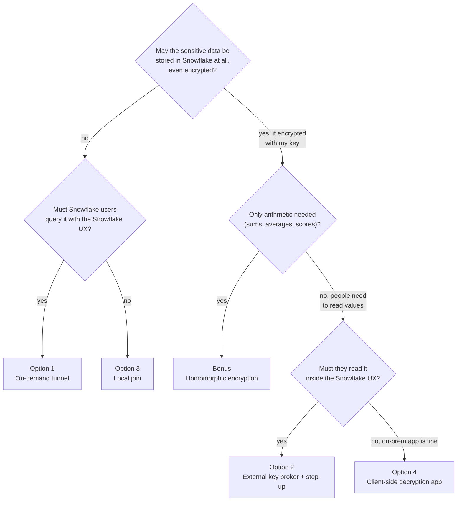

# Customer-held controls for data sovereignty – overview

These options describe ways to keep maximum control over the most sensitive data while Snowflake remains the
analytics platform. Each one draws the trust boundary in a different place.

## The question each option answers

| | Option 1 – Tunnel | Option 2 – Key broker | Option 3 – Local join | Bonus – Homomorphic | Option 4 – Client-side decrypt |
|---|---|---|---|---|---|
| **Where the sensitive data lives** | on-prem Iceberg lake | Snowflake, as AES-256-GCM ciphertext | on-prem only | Snowflake, as HE ciphertext | Snowflake, as AES-256-CBC ciphertext |
| **Who holds the key / switch** | data owner (tunnel on/off, TTL) | data owner (KMS + broker in own AWS account) | data owner (data never leaves) | data owner (secret key never leaves) | data owner (key only in on-prem app) |
| **When Snowflake can see plaintext** | only while the tunnel is up, in query memory | only during a `RUNNING` query of a stepped-up user | never | never | never |
| **Snowflake UX kept** (notebooks, SQL, BI, Cortex) | yes | yes, transparently via masking policy | no (local notebook) | partly (aggregates; decrypt client-side) | no (on-prem Streamlit app) |
| **Result cache exposure** | none (VOLATILE + nonce; notebook path never caches) | none (queries with external functions aren't reused) | none | ciphertext only | ciphertext only |
| **Snowflake governance on sensitive rows** | RBAC on function/view; full Horizon only if synced | full (masking, RBAC, access history) | none; on-prem governance | RBAC; values opaque | RBAC on ciphertext; app RBAC + OIDC on plaintext |
| **Step-up / justification** | `--reason` on `tunnel-up`, audit log | TOTP + justification, time-boxed grant | n/a (local access control) | n/a | OIDC login to app; app roles |
| **Performance** | network-bound; scalar UDF best for bounded queries | native decryption speed; ~4 s per decrypting query incl. the RUNNING call-back (once per key, not per row) | limited by local host | heavy (large ciphertexts, slow ops) | pull + decrypt locally; no pushdown on encrypted columns |
| **Operating effort** | SPCS service + on-prem agent + lake | AWS stack (KMS, Lambda, API GW, DynamoDB) + API integration | lowest | moderate (Python UDFs, key handling) | low (one app + key handling) |
| **Typical fit** | regulated data that may not be stored in a foreign cloud | highly sensitive columns that must stay in the platform but under external key control | data that must never leave the premises | salary / financial numbers needing only arithmetic | encrypted-at-rest data for a small, trusted on-prem analyst group |

### Option 2b – lighter variant of Option 2

Same ciphertext-in-Snowflake model, but a Python UDF with an External Access Integration fetches the key directly
from the customer's vault and keeps it in a per-process memo. Measured: the memo lasts for **one query** (one fetch
per parallel process, e.g. 8 instead of 5,000), and was not reused across queries, sessions or roles on a warm
warehouse. Less infrastructure than Option 2, but the key service sees only the integration, not the analyst or query
– no step-up or query_id call-back unless added. Details: [02b-eai-key-cache.md](02b-eai-key-cache.md).

### Option 2c – 2b plus device-flow approval and a query-bound call-back

The analyst approves a device code on a second device (TOTP and a justification) and gets an API key that is valid
only for that user, account and session. Every key fetch passes the query's own query_id; the broker checks that
the query is RUNNING, calls the 2c function and is the only such query in the session. Measured: 45/45 correct
bindings, one call-back per query, about 0.3 s extra per query. A session-lookup alternative was weaker on
back-to-back queries (8/15). Details: [02c-device-flow-apikey.md](02c-device-flow-apikey.md).

## Decision guide

The options can be combined. One possible layering: native Snowflake data for the bulk, Option 2 for PII columns,
homomorphic encryption for salary figures, and Option 1 or 3 for the few datasets that may not be stored in the
cloud at all.

## Threat model (what each option is designed to resist)

| Threat | Opt 1 | Opt 2 | Opt 3 | HE |
|---|---|---|---|---|---|
| Cloud provider / platform operator reads data at rest | ✔ (not stored) | ✔ (ciphertext, key external) | ✔ | ✔ |
| Over-privileged Snowflake admin queries sensitive data | ✔ when tunnel down | ✔ without step-up grant | ✔ | ✔ |
| Stolen Snowflake credentials | ✔ when tunnel down | ✔ (no TOTP → no grant) | ✔ | ✔ |
| Replay of a previous authorization | n/a | ✔ (query_id must be RUNNING) | n/a | n/a |
| Legal compulsion against the platform | ✔ | ✔ (key held elsewhere) | ✔ | ✔ |
| Authorized user exfiltrates what they're allowed to see | ✘ | ✘ (could be reduced with unload/CTAS controls) | ✘ | ✔ (sees only aggregates) |

## Demo environment

* One Snowflake account (AWS eu-central-1), database `SOVEREIGNTY_DEMO`
  * `OPT1_TUNNEL` · `OPT2_BYOK` · `OPT3_SPLIT` · `HE`
* Shared synthetic dataset: `shared/sample_data/generate.py`. 200 employees. Public columns: department,
  country, level. Sensitive columns: name, national ID, IBAN, salary, bonus.
* AWS (Option 2): eu-central-1, CDK stack `SovereigntyKeyBroker`.
