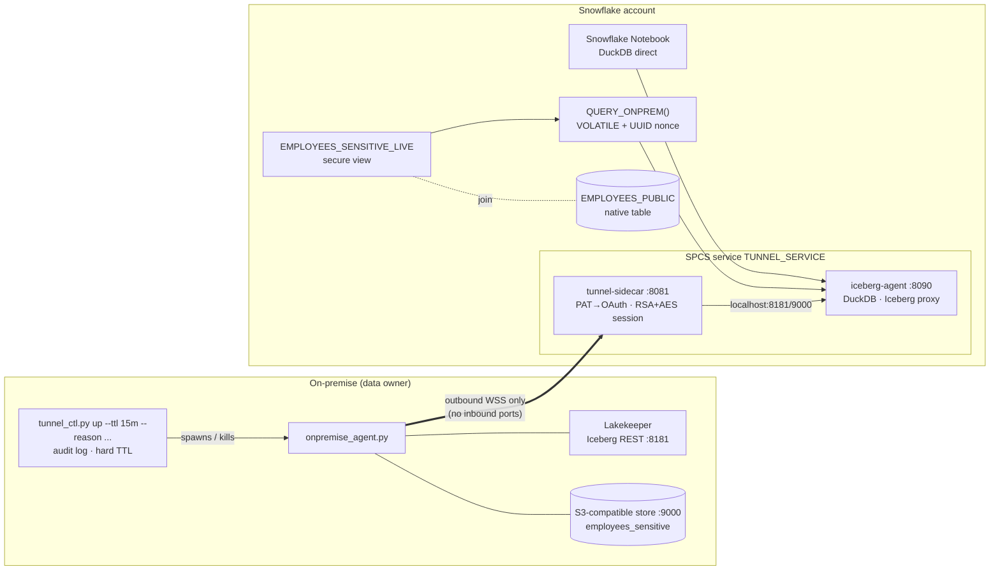
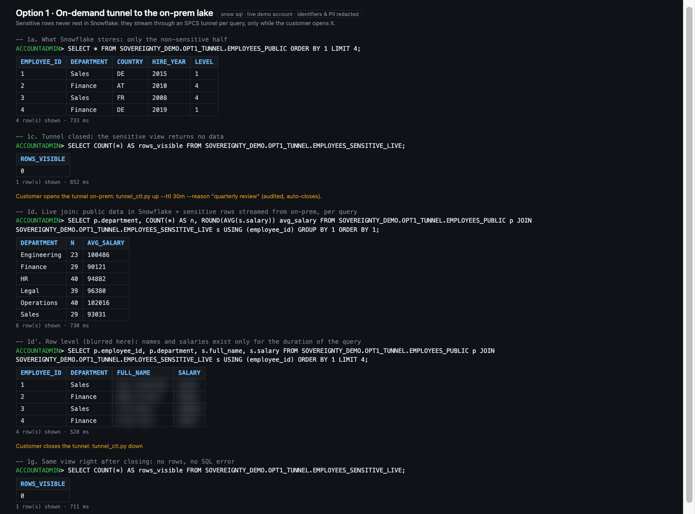
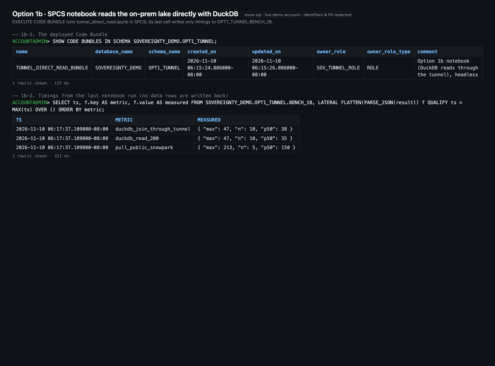

# Option 1 – On-demand sovereignty tunnel

**Idea:** Snowflake stays the strategic platform. It holds the majority of the data, and users keep notebooks,
worksheets and the Snowflake UX. Ultra-sensitive tables stay on-premise in an Apache Iceberg lake. They become
reachable from Snowflake **only while the data owner opens an outbound tunnel**, and only for a time-boxed window.
Results are never served from the Snowflake result cache.

Based on [iceberg-snowflake-tunnel](https://github.com/sfc-gh-kkeller/iceberg-snowflake-tunnel) /
[blog post](https://kevinkeller.org/posts/data-sovereignty-querying-onprem-iceberg-from-snowflake/), with the
hardening below.

## Architecture



## What was added on top of the original repo

| Area | Change |
|---|---|
| **On-demand** | `agent/tunnel_ctl.py`. `up` requires `--ttl` (max 4 h) and `--reason`, starts the agent, and kills it at the TTL no matter what. `down` is the kill switch. Every open/close is written to `agent/tunnel_audit.log`. Optional `--suspend-service` also suspends the SPCS service. |
| **No result cache** | Analysts call `QUERY_ONPREM()`, a `VOLATILE` SQL wrapper that adds `UUID_STRING()` (a non-reusable function per the docs) to every call, so there is never a cache hit. `USE_CACHED_RESULT=FALSE` is set on the demo user as well. |
| **Identity** | Dedicated `TYPE=SERVICE` user `SOV_TUNNEL_AGENT` with a role-restricted PAT (30 days). A network policy allows only the on-prem egress IP. |
| **Secrets** | The handshake secret is generated and stored as a Snowflake `SECRET`, then injected into the sidecar. The `test-secret-key` default is gone. |
| **Egress** | The DuckDB extension network rule is limited to `extensions.duckdb.org:443/80` (the original also allowed `0.0.0.0:443/80`). |
| **Storage** | MinIO no longer ships public images, so the demo uses **RustFS** (Apache-2.0, S3-compatible). The bucket is not public: it has a read-only bucket policy, reachable only on-prem and through the tunnel. |
| **Lakekeeper** | DuckDB `ATTACH ... ACCESS_DELEGATION_MODE 'none'`, so the agent uses its own credentials instead of vended or remote-signed ones. |

## Verified in the demo account

* With the tunnel up, the join of `EMPLOYEES_PUBLIC` (Snowflake) and `EMPLOYEES_SENSITIVE_LIVE` (on-prem) returns
  average salary per department.
* **Cache test:** four identical runs, two of them with `USE_CACHED_RESULT=TRUE` explicitly set in the session.
  All four query IDs appear in the on-prem-facing agent log, so each one was executed through the tunnel.
* After `tunnel-down`, the same call fails with `Could not connect to server ... localhost:8181`. There is no
  path to the data.

## Run

```bash
cd opt1-tunnel
pixi run start && pixi run seed            # on-prem lake (Lakekeeper + RustFS) with employees_sensitive
bash snowflake/deploy.sh                    # prereqs → images → service (first time only)
pixi run tunnel-up --ttl 15m --reason "HR-2026-114 payroll audit"
# in Snowflake:
#   SELECT p.department, AVG(s.salary) FROM SOVEREIGNTY_DEMO.OPT1_TUNNEL.EMPLOYEES_PUBLIC p
#   JOIN SOVEREIGNTY_DEMO.OPT1_TUNNEL.EMPLOYEES_SENSITIVE_LIVE s USING (employee_id) GROUP BY 1;
pixi run tunnel-down
```

Notebook path (zero persistence): `notebooks/iceberg_demo.ipynb` → section *Option 1 – join on-prem
sensitive data with Snowflake data, in memory only*.

## Sovereignty spectrum within this option

| Pattern | Data persisted in Snowflake | Result cache | Snowflake governance |
|---|---|---|---|
| Notebook + DuckDB direct | never | n/a | no (pandas in notebook memory) |
| `QUERY_ONPREM()` / `EMPLOYEES_SENSITIVE_LIVE` | no | **never** (nonce + VOLATILE) | RBAC on function/view |
| `query_iceberg_to_table()` (original) | yes, explicitly | yes | full Horizon |

## Option 1b – a notebook and your own query engine, bypassing Snowflake's query engine

Customers can run a notebook on Snowpark Container Services and query through the tunnel with their own engine,
such as DuckDB. The notebook can be a Snowflake Notebook or a custom one on SPCS, such as Jupyter or marimo. No SQL
then runs on Snowflake's own query engine (the virtual warehouse) for the sensitive data. There is no query result,
so nothing reaches the result cache, `RESULT_SCAN` or the query history results. The data exists only in the
notebook container's memory while the session runs. With a Snowflake Notebook, users keep the familiar Snowflake
experience: the editor, Snowflake sign-in and RBAC, and the joins with Snowflake data in the same notebook.

Demo: `notebooks/tunnel_direct_read.ipynb`, set up with `snowflake/20_notebook.sql`.

**Trade-offs**

| Gained | Lost |
| --- | --- |
| No query result and no result cache in Snowflake for the sensitive data | The compute power of Snowflake's query engine: the work is limited to one notebook container |
| The Snowflake experience is kept with Snowflake Notebooks | On-demand elasticity: no warehouse scaling, query acceleration or multi-cluster |
| Any engine the customer chooses (DuckDB, PyIceberg, Polars, …) | Snowflake governance on that data path: no masking or row access policies, and no access history of the reads themselves |

**Gap: passing the user's identity through to the data source.** The demo authenticates to the on-prem Iceberg
catalog with the agent's own credentials. It does not pass the notebook user's identity through to the on-prem
source. In a real deployment that has to be solved in one of these ways:

- **out of band**, for example with on-prem access control on the agent or the catalog side;
- with a **token from an external identity provider**, for example through an OAuth device-code flow started from
  the notebook (with helper functions or UDFs), similar to Option 2c;
- by engineering a **proof of the Snowflake identity** that the source can check, for example from the Snowflake
  user context, request headers in SPCS, or secrets made available to the notebook.

The demo does not cover this, because on-prem data sources behind the tunnel, and their authentication
requirements, vary widely. A future addition is planned: one example pattern for seamless Iceberg catalog
authentication from a notebook on SPCS.

## Possible next steps

* Schedule `tunnel-up` from an approval workflow (ServiceNow, a Slack approval) instead of manually.
* Push `tunnel_audit.log` into the SIEM; alert on tunnel-up outside business hours.
* Restrict usage of `QUERY_ONPREM` to a dedicated analyst role and add a row access policy on the view.
* The scalar service function is `MAX_BATCH_ROWS = 1` and returns one VARIANT per call. Large extracts belong in
  the notebook pattern.

## Screenshots

Captured from the demo account. Names, IBANs, individual salaries, account identifiers, endpoint URLs, QR codes and keys are blurred or replaced.


*Option 1: tunnel closed (0 rows), opened by the owner, live join, closed again (0 rows, no SQL error)*


*Option 1b: Code Bundle run in SPCS; the notebook writes only timings back*
