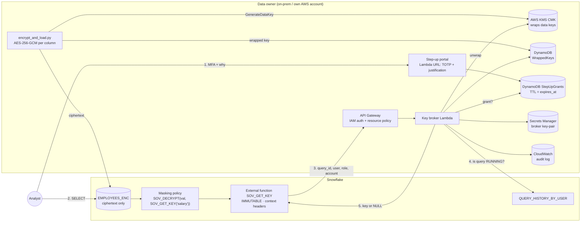
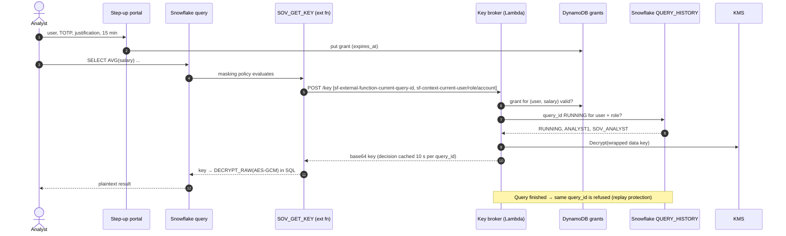

# Option 2 – Column-level AES-256 + external key broker with step-up

**Idea:** sensitive columns are encrypted with AES-256-GCM *before* they reach Snowflake. Snowflake holds
ciphertext only and never stores a key. A masking policy asks an **external key broker** in AWS for the key
whenever a query actually needs it. The broker releases the key only if all of these hold:

1. the request is IAM-signed by the Snowflake API integration role (API Gateway, `AWS_IAM` auth + resource policy),
2. the user did a **step-up outside Snowflake** (TOTP + written justification) that is still valid,
3. a **call-back to Snowflake** confirms that this exact `query_id` is `RUNNING` right now, issued by this user,
   under this role, in this account.

Snowflake notebooks, worksheets, BI tools and Cortex all keep working. The data owner keeps the key and
the kill switch.

## Architecture



## Key release sequence



## Why an External Function, not an External Access UDF

* Only External Functions get the query ID and the context headers (`CURRENT_USER`, `CURRENT_ROLE`, `CURRENT_ACCOUNT`)
  injected by Snowflake. The caller cannot forge them in SQL, because they are not function arguments.
* `CURRENT_QUERY_ID()`-style information isn't available inside a masking policy. The External Function header
  provides it.
* `IMMUTABLE` plus a constant argument (`'salary'`) lets Snowflake treat the key as a per-query constant. The
  broker additionally caches its *allow* decision per `query_id` for 10 seconds and its *deny* decisions for
  60 seconds, so one query costs one Snowflake call-back regardless of row count.

## Components

| Path | What |
|---|---|
| `client/encrypt_and_load.py` | KMS `GenerateDataKey` per classification, encrypts columns locally, stores only the wrapped key, loads ciphertext |
| `client/enroll_user.py` | Admin enrollment of a user's TOTP secret and entitled classifications |
| `client/demo.py` | Scripted demo: viewer → denied analyst → step-up → plaintext → replay attempt → revoke |
| `lambda/broker/` | Key broker: grant check, query_id call-back via SQL API (key-pair JWT), KMS unwrap, audit |
| `lambda/stepup/` | Step-up portal: HTML form + JSON API, TOTP verify, time-boxed grant |
| `infra/app.py` | CDK: KMS CMK, 3 DynamoDB tables, 2 Lambdas, REST API (IAM auth), IAM role for Snowflake |
| `snowflake/10_objects.sql` | Roles, ciphertext table, `SOV_DECRYPT` (pure SQL `TRY_DECRYPT_RAW`), broker service user |
| `snowflake/20_extfn_policies.sql` | API integration, external function, masking policies, typed secure view |
| `tests/test_broker.py` | Offline tests: allow, one call-back per query, no grant, wrong account, replay, fail-closed |

## Run

```bash
aws login                                   # AWS credentials for eu-central-1
./setup.sh                                  # Snowflake objects → CDK (2 passes) → secrets → policies → encrypt+load
pixi run enroll <SNOWFLAKE_USER> # scan QR with an authenticator app
(cd client && uv run demo.py)
```

## Verified behaviour (live, Snowflake + AWS eu-central-1)

`client/demo.py` output, summarized:

| Step | Result | Broker reason |
|---|---|---|
| `SOV_VIEWER` | `**ENCRYPTED**`, `AVG(salary)` = NULL | policy never calls the broker |
| `SOV_ANALYST`, no step-up | `**KEY DENIED**` | `no_stepup_grant` (no call-back to Snowflake needed) |
| TOTP + justification, 5 min | grant written for `salary` and `pii` | – |
| `SOV_ANALYST`, with grant | names and salaries in clear; Engineering 100,486 · Finance 90,121 · … (identical to Option 1) | `running`, justification logged |
| Replay of that query_id after it finished | `NULL` key | `query_not_running(SUCCESS)` |
| Revoke grant | `**KEY DENIED**` again | `no_stepup_grant` |

**Key-fetch economics:** one query that decrypts 5 columns × 200 rows produced **2 broker invocations, one per
classification (`salary`, `pii`), with 1 row each**. That's **2 call-backs to Snowflake in total**.
`IMMUTABLE` plus a constant argument means the key is fetched once per distinct key per query, not per row.

**Latency:** a decrypting query over 200 rows takes about 4 s (p50, X-Small warehouse; plaintext 0.1 s); most of
it is the external function round trip, and a denied query takes about 3.3 s. The call-back limits
`QUERY_HISTORY_BY_USER` with `END_TIME_RANGE_START` (last 10 minutes): with only `RESULT_LIMIT => 1000` it took
8–10 s for a busy user and the query 14.6 s. Running queries are still found. The data key unwrap is cached in
the Lambda. A warm, dedicated warehouse for the broker would avoid any resume delay. See `bench/RESULTS.md`.

Also verified:

* Python `AESGCM` envelope → Snowflake `TRY_DECRYPT_RAW` round-trip: correct key gives plaintext; a wrong key or
  wrong AAD gives `NULL`, and the policy then shows `**KEY DENIED**`.
* With only `MONITOR` on `SOV_WH`, the broker service user sees another user's query as `RUNNING` (with user
  and role). This is least privilege, and decryption is implicitly limited to monitored warehouses: a query on any
  other warehouse returns `query_not_found`, so access is denied.
* Errors fail closed. A deliberately broken KMS call during development returned `NULL` keys with reason
  `broker_error:AttributeError` and never plaintext.
* Offline broker tests: 6/6 pass (`tests/test_broker.py`).
* Secondary roles matter: a user holding `SOV_ANALYST` as a *secondary* role triggers the broker too
  (`IS_ROLE_IN_SESSION`). The demo uses `USE SECONDARY ROLES NONE` for clean personas. Alternatively, the policy
  could test `CURRENT_ROLE()` only.

## Possible hardening for production

* The broker service user has an allow-all network policy because Lambda egress IPs are dynamic. A VPC Lambda with
  a NAT gateway and an Elastic IP could pin it to a single IP.
* Replace TOTP with the corporate IdP (Okta/Entra step-up `acr`, Duo push), optionally with four-eyes approval.
* Mirror broker audit events into a Snowflake event table or the SIEM, keyed by `query_id`, so every key release
  can be traced to a query in `ACCESS_HISTORY`.
* Rotate data keys (`encrypt_and_load.py --rotate`) and the KMS CMK (automatic rotation is already on).
* Consider pinning `MAX_BATCH_ROWS` and reserving Lambda concurrency to cap the blast radius of runaway queries.

## Residual risks to discuss openly

* While a query runs, the plaintext key exists in Snowflake compute memory and the plaintext result is shown to
  the user. This option controls *when* and *for whom* decryption happens; it doesn't make computation
  blind (Option 3 and homomorphic encryption cover that).
* Result sets shown to an authorized user can be copied by that user (`CREATE TABLE AS`, export). These could be
  constrained further with Snowflake controls (e.g. no `CREATE TABLE` in the analyst role, `PREVENT_UNLOAD_*`,
  restricted stages).
* **Result cache:** the Snowflake documentation on persisted query results lists "the query does not include
  external functions" as a condition for reuse. Every query that decrypts through the masking policy
  calls `SOV_GET_KEY`, so it is always re-executed and re-authorized by the broker. The demo also sets
  `USE_CACHED_RESULT = FALSE` on the analyst user as defense in depth.
  `RESULT_SCAN(<query_id>)` by the *same* user within 24 h could still show a past result. A role without access
  to its own query results is not a concept in Snowflake, so this is worth stating explicitly.
* **Stored results and Dynamic Tables:** the masking policies return `**KEY DENIED**` when the broker refuses, and
  `CREATE TABLE AS` would store that placeholder as a value. External functions are not supported in Dynamic
  Tables at all, so pipelines need an External Access UDF variant (2b, 2c or 2d) with a fail-closed (strict) mode.
