# Option 2b – Key fetched by an External Access UDF, cached per query

**Idea:** a variant of Option 2 with less infrastructure. Columns are still AES-256-GCM ciphertext in Snowflake, but
there is no API Gateway, Lambda or external function. A **Python UDF with an External Access Integration** fetches
the data key directly from the customer's key service (vault, KMS, HSM gateway – optionally over outbound
PrivateLink) and keeps it in a **module-level memo** inside the Python process. Decryption is native
`DECRYPT_RAW(…, 'AES-GCM')` in SQL; the UDF only supplies the key.

Origin: the Vodafone RTM proof of concept (`vodafone-app/`, pattern A), measured again here for persistence.



```python
_keys = {}                                  # module level = per Python UDF process
def get_key(name):
    if name not in _keys:                   # first row in this process
        jwt = _snowflake.get_oauth_access_token('vault')
        _keys[name] = fetch_from_vault(name, jwt)
    return _keys[name]
```

## What we measured (Snowflake on AWS eu-central-1, X-Small standard warehouse)

Probe UDFs `SOVEREIGNTY_DEMO.OPT2B_WARM_CACHE.PROCESS_PROBE` (no network) and `PROCESS_PROBE_EAI` (with an External
Access Integration) report a per-process ID and whether the memo already held a value.

| Scenario | Python process | Memo hit |
|---|---|---|
| New session per query, same role, ~2 s apart | new for every query | no |
| Different roles (ACCOUNTADMIN → SOV_ANALYST → SOV_VIEWER) | new for every query | no |
| Same session, 4 queries back to back (incl. a 20 s pause) | new for every query | no |
| Same, UDF with External Access Integration | new for every query | no |
| One query over 5,000 rows | 8 parallel processes | 4,992 / 5,000 → **8 key fetches instead of 5,000** |

From the Vodafone POC (2,000 rows, mock vault behind PrivateLink): plain UDF 2,000 vault calls; `IMMUTABLE` UDF
returning rows ~1,000+ calls and ~20 s; memo UDF **1 call, ~1 s**.

**Conclusion:** the memo lives for **one query** (per process, per parallel worker). In these tests a warm
warehouse did **not** carry the key over to the next query, session or role. That is good for security (no key
lingering between users) and means the cost is one fetch per process per query. This behaviour is observed, not a
documented guarantee; it could differ for other warehouse types or change over time, so a design should not rely
on either reuse *or* non-reuse – see "Hardening" below.

## Compared with Option 2

| | Option 2 – key broker | Option 2b – EAI key fetch |
|---|---|---|
| Infrastructure | API integration, API Gateway, Lambda, DynamoDB, KMS | network rule, secret / OAuth integration, EAI – key service of choice |
| Key fetches | ~1 per query (`IMMUTABLE` external function) | 1 per Python process per query |
| Caller context to the key service | user, role, account, **query_id** (headers) | only the integration identity, unless the UDF passes context itself |
| Per-query authorization | step-up grant + call-back "is this query RUNNING for this user?" | role grants on the UDF / masking policy in Snowflake |
| Kill switch | revoke grant, disable broker | `ALTER EXTERNAL ACCESS INTEGRATION … SET ENABLED = FALSE`, revoke token in the IdP |
| Latency | ~4 s per query (external function + call-back) | ~1 s per query (fetch) |

## Pros

* Much less to build and run: no API Gateway or Lambda, any HTTPS key service, outbound PrivateLink supported.
* Key never stored in Snowflake; it exists in UDF process memory only for the duration of one query (as measured).
* Efficient: one fetch per process per query instead of one per row.
* Native AES-GCM decryption in SQL; works with masking policies and views like Option 2.

## Cons

* No per-query identity at the key service by default: the vault authorizes the **integration**, not the analyst.
  Authorization relies on Snowflake RBAC (who may call the UDF / sees the unmasked column).
* No step-up or replay protection out of the box (Option 2 has both).
* During a query the key is in Snowflake compute memory (same as Option 2).
* Process lifetime is platform behaviour, not a contract.

## Possible hardening

* Pass `CURRENT_USER()`, `CURRENT_ROLE()` and `CURRENT_STATEMENT()` / query ID as UDF arguments and send them to the
  key service so it can log or enforce per user.
* Put a TTL on the memo (e.g. 60 s) and key it by (key name, user, role) so behaviour stays safe even if processes were
  ever reused.
* Short-lived OAuth tokens (client credentials), `ENABLED = FALSE` on the EAI as the kill switch, alerting on vault
  access outside expected patterns.
* Combine with Option 2's step-up idea by having the key service check a time-boxed grant before releasing the key.

## Option 2b inside incremental Dynamic Tables (tested 2026-11-10)

Question: can a pipeline built on incremental Dynamic Tables decrypt per row with a key that stays in AWS? External
functions are not supported in DTs (docs: "Supported queries for dynamic tables"); scalar UDFs are, IMMUTABLE anywhere
and VOLATILE in the SELECT list only. Test in `SOVEREIGNTY_DEMO.OPT2B_DT_TEST`
([02_dt_kms_test.sql](../opt2b-warm-cache/snowflake/02_dt_kms_test.sql), seed
[seed.py](../opt2b-warm-cache/client/seed.py)):

* KMS key in eu-central-1, one AES-256 data key from `GenerateDataKey`; only the wrapped blob is in the UDF.
* IAM user allowed `kms:Decrypt` on that key only, with encryption context `purpose=hh-dt-test`; its access key is a
  PASSWORD secret bound to the UDF; EAI egress only to `kms.eu-central-1.amazonaws.com:443`.
* Two secure Python UDFs (`GET_KEY_IMM` IMMUTABLE, `GET_KEY_VOL` VOLATILE) unwrap the key once per Python process and
  pass the DT name in the boto3 user agent. `DECRYPT_RAW(..., 'AES-GCM', tag)` decrypts in SQL.
* DTs `SILVER_IMM` / `SILVER_VOL`: `TARGET_LAG = '1 minute'`, `REFRESH_MODE = INCREMENTAL`.

| Check | IMMUTABLE UDF | VOLATILE UDF |
| --- | --- | --- |
| Created as INCREMENTAL, `refresh_mode_reason` NULL | yes | yes |
| Scheduled refreshes (user `SYSTEM`) reach KMS and decrypt new rows | yes, 3 × 100 rows | yes, 3 × 100 rows |
| Replace UDF with a new data key (key rotation) | **REINITIALIZE, then every refresh FAILED** ("Decryption failed") because old rows were re-decrypted with the new key | stays INCREMENTAL; new rows decrypted with the new key, old rows untouched; 1,400 / 1,400 correct |
| CloudTrail | one `Decrypt` per Python process per refresh, `sfdt/<DT>` in the user agent, Snowflake egress IP, encryption context logged | same |
| Average refresh time | about 3.8 s (X-Small, includes KMS calls) | same |

Other observations:

* Query history: the secret's PASSWORD is shown as `☺☺☺☺☺` in the CREATE SECRET text; the access key ID in USERNAME is in
  clear. The secret value did not appear in any other query text.
* AWS-side audit identifies the DT (via the caller tag the UDF sends) and the time, not a Snowflake query ID; correlate
  with `DYNAMIC_TABLE_REFRESH_HISTORY` by time. ACCESS_HISTORY was not checked (Account Usage latency).
* KMS key rotation (`rotate-key-on-demand`) is transparent: the old wrapped blob still decrypts.

What this means:

* It works: the data key is stored only in AWS (wrapped), every unwrap is in CloudTrail, and the IAM user can be
  disabled from AWS as a kill switch.
* It does not meet "the key cannot leave AWS" strictly: the plaintext data key is in UDF memory during each refresh, and
  an AWS credential is now a Snowflake SECRET (the bootstrap credential), so that credential gets the controls the
  original design gave the key.
* Use a VOLATILE UDF. With IMMUTABLE, any change to the key UDF reinitializes the DT and re-decrypts all history.
* Key rotation needs a key ID per row (or envelope per batch), so old rows keep their own wrapped key.

## Run the probe

```sql
-- opt2b-warm-cache/snowflake/00_probe.sql, 01_probe_eai.sql deploy the probes; then, each in a new worksheet run:
SELECT SOVEREIGNTY_DEMO.OPT2B_WARM_CACHE.PROCESS_PROBE_EAI('salary');          -- note "process"
SELECT SOVEREIGNTY_DEMO.OPT2B_WARM_CACHE.PROCESS_PROBE_EAI('salary');          -- new process, cache_hit = false
SELECT COUNT(DISTINCT SOVEREIGNTY_DEMO.OPT2B_WARM_CACHE.PROCESS_PROBE_EAI('salary'):process) AS processes,
       COUNT_IF(SOVEREIGNTY_DEMO.OPT2B_WARM_CACHE.PROCESS_PROBE_EAI('salary'):cache_hit::BOOLEAN) AS memo_hits
FROM TABLE(GENERATOR(ROWCOUNT => 5000));                                       -- few processes, many hits
```
