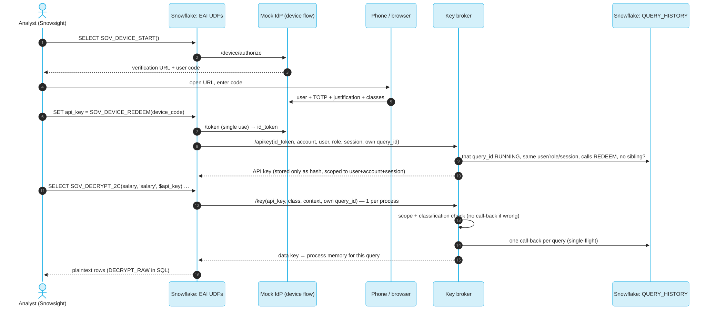

# Option 2c – Device-code sign-in, scoped API key, query-bound key fetch

Option 2c combines Option 2's controls (a person approves, with a justification, and each key
release is tied to a query that is running right now) with Option 2b's lightweight transport (an
External Access UDF instead of an External Function and API Gateway).

## The flow



```sql
SELECT item, value FROM TABLE(SOV_DEVICE_LOGIN()) ORDER BY seq;  -- device code, user code, QR page link, ASCII QR
-- scan the QR: approval page opens with code + user pre-filled; TOTP, classes, justification -> approve
SET device_code = '<device_code>';
SET api_key = (SELECT SOV_DEVICE_REDEEM($device_code):api_key::STRING);
SELECT department, AVG(TRY_TO_NUMBER(SOV_DECRYPT_2C(salary, 'salary', $api_key)))
FROM SOVEREIGNTY_DEMO.OPT2C_DEVICE_FLOW.EMPLOYEES_ENC GROUP BY 1;
```

| Step | What is checked | Where |
|---|---|---|
| Device approval | TOTP of the Snowflake user, entitlement per classification, justification ≥ 10 chars | mock IdP |
| Token | device code single use, id_token valid 5 min, `aud = sovereignty-key-broker` | mock IdP → broker |
| API key minting | id_token signature, `sub` = calling user, `jti` single use, **call-back**: the redeeming query is running | broker |
| API key | random 256 bits, stored only as SHA-256, scoped to **user + account + session**, classifications, TTL ≤ 8 h | broker state table |
| Key fetch | scope and classification first (no call-back if wrong), then **call-back** on the query's own query_id | broker |

The analyst only passes `$api_key`. Secure SQL wrappers add `CURRENT_ACCOUNT()`, `CURRENT_USER()`,
`CURRENT_ROLE()`, `CURRENT_SESSION()` and the query's own query_id (`SELF_QUERY` view), so they
cannot be typed in by hand.

## Making the phone step easy

- `SOV_DEVICE_LOGIN()` returns the approval link as an **ASCII QR** in the result grid, using the
  `qrcode` package from the Snowflake Anaconda channel and half-block characters.
- The same result has a **QR page** link (`/qr` on the mock IdP, an SVG QR rendered by the Lambda).
  If the grid squeezes the ASCII QR, open the link on the laptop and scan it from the screen.
- The approval link carries the user code and the Snowflake user (`login_hint`), so on the phone you
  only type the 6-digit TOTP. The field uses `autocomplete="one-time-code"` and a numeric keypad.
- TOTP enrollment uses the same secret as Option 2: `cd opt2-keybroker && pixi run totp-qr` (show the
  existing QR) or `pixi run enroll` (new secret).

## How does the broker know which query is asking?

A UDF cannot read its own query_id directly. Two ways were measured:

- **A – self-id.** The query reads its own id with the
  [community-article pattern](https://community.snowflake.com/s/article/How-to-get-current-query-id-at-the-time-of-its-submission)
  (`QUERY_HISTORY_BY_SESSION() ORDER BY start_time DESC LIMIT 1`, here wrapped in a secure view)
  and passes it to the broker. The broker checks that exact id: RUNNING, same user, role and
  session, the query text calls the 2c function, and no other such query is running in that session.
- **B – session lookup.** The broker looks for the one RUNNING query of that user in that
  session whose text calls the 2c function.

### Part 1 – does the self-id join return the query's own id? (Snowflake only, 20 runs each)

| Context | Result |
|---|---|
| Sync query, inside a Python UDF argument, behind a view, behind a secure view | 20/20 correct each |
| Async single query | 20/20 |
| Two async queries in one session | 10/10 got their own id (observed, not guaranteed) |
| Stored procedure (`EXECUTE AS CALLER`) / Snowflake Scripting block | returns the **inner** statement's id (the one calling the UDF), not the CALL – which is what the broker needs |
| Owner's-rights stored procedure | not possible: "information on the current user is not accessible" → denied |

### Part 2 – through the broker (X-Small, 15 runs each, `pixi run bench`)

| Scenario | A: self-id | B: session lookup |
|---|---|---|
| Correct binding, 10 / 5,000 / 100,000 rows | 45/45 | 45/45 |
| Back-to-back queries with the same key | **15/15** | 8/15 – 7 bound to the *previous* query (session-keyed decision cache) |
| Forged query_id | denied (`query_not_found_in_session`) | n/a |
| Finished query_id replayed from outside Snowflake | denied (`query_not_running(SUCCESS)`) | n/a |
| Two concurrent async queries in one session | denied (fail closed) – before hardening, 5/10 were allowed with the sibling's id | denied (ambiguous) |
| Snowflake call-backs per query | 1 (single-flight; 1 process asked) | 1 (8 processes asked, cache absorbed 7) |
| Call-back time p50 | 430–515 ms | 560–785 ms |
| Query wall time p50 vs no binding (≈2.1 s) | +0.2–0.4 s | +0.4–0.9 s |

**Result: A wins.** It is exact (no stale-cache risk), slightly faster, and a forged id cannot be
used. Running the self-id inside the query also keeps the UDF call in one process, which gives one
key request instead of eight. The test found one weakness in A, a sibling async query in the same
session; it was closed by also requiring "no other such query running in this session". B remains
in the code (`mode = 'B'`) as a fallback for clients where the self-id join is not possible.

### End-to-end (`pixi run e2e -- --auto`)

All checks pass:

- redeem before approval → `authorization_pending`
- API key issued, and the device code cannot be used a second time
- 200/200 salaries decrypt in ~3.3 s
- `pii` not approved → NULL
- forged key → NULL
- same key used from another session → NULL
- stolen key with a finished query_id, sent directly to the broker → 403 `query_not_running(SUCCESS)`

Audit: one `release` line per query, carrying the justification and bound query_id.

## Pros and cons

| Pros | Cons |
|---|---|
| A person approves on a second device with MFA and a written justification, per session | More moving parts than 2b: an IdP (mock here; Okta or Entra in practice) and a broker |
| The API key is useless outside the session it was issued for and outside a running query | Each query adds roughly 0.3 s for the call-back |
| Each key release is bound to an exact, running query_id and audited | The self-id pattern is not a documented contract; owner's-rights procedures cannot use it |
| No API Gateway or API integration; any HTTPS host, PrivateLink possible | The API key sits in a session variable (`SHOW VARIABLES` shows it to the same user) |
| Wrong scope or classification is refused without a call-back | The key is in compute memory during the query (as in Options 2 and 2b) |

## Run it

```bash
cd opt2c-device-flow
pixi run setup              # CDK (keeps the Option 2 trust) + Snowflake objects
pixi run test               # 12 unit tests, no cloud
pixi run bench-selfid       # part 1
pixi run bench              # part 2
pixi run e2e                # interactive device flow; `-- --auto` uses the enrolled TOTP
```

Objects: `SOVEREIGNTY_DEMO.OPT2C_DEVICE_FLOW` (`EMPLOYEES_ENC`, `SELF_QUERY`, `SOV_DEVICE_START`,
`SOV_DEVICE_REDEEM`, `SOV_GET_KEY_2C`, `SOV_DECRYPT_2C`, `SOV_BIND_PROBE`),
EAI `SOV_OPT2C_EAI`, network rule `OPT2C_EGRESS`. AWS: `Opt2cMockIdp`, `Opt2cBroker`,
`Opt2cState` table and `sovereignty-demo/opt2c-signing` secret, all in stack `SovereigntyKeyBroker`.

**Stored results and Dynamic Tables:** `SOV_DECRYPT_2C` returns NULL when access is denied, which suits interactive
queries. If its result is stored (`CREATE TABLE AS`, an incremental Dynamic Table), a denial becomes a stored NULL
that an incremental Dynamic Table never revisits. Use [Option 2d](02d-remote-decrypt.md)'s `SOV_DECRYPT_2D_STRICT`,
which raises instead, or check for unexpected NULLs before storing.
