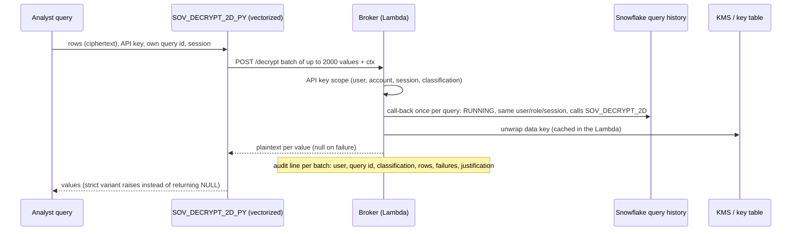

# Option 2d – Remote decrypt: the key never enters Snowflake

**Idea:** the same approval and query binding as [Option 2c](02c-device-flow-apikey.md), but the broker does not
hand out the data key. A vectorized External Access UDF sends batches of ciphertext to the broker in AWS, the
broker decrypts there and returns plaintext. Snowflake never holds the key, only ciphertext and, for an approved
query, the plaintext result. The same shape works for external **de-tokenization** (send tokens, get values).

Adapted from the decrypt-as-a-service pattern in
[pii-key-stays-in-aws](https://github.com/sfc-gh-kkeller/pii-key-stays-in-aws), combined with this repo's
per-user, per-query binding.



## How it differs from 2c

| | 2c Device flow (key fetch) | 2d Remote decrypt |
| --- | --- | --- |
| Data key in Snowflake | yes, in UDF memory for the query | **never** |
| What crosses the network | the key, once per query | ciphertext out, plaintext back, per batch |
| Broker sees | key requests | every batch: row count, failures, query id |
| Approval, API key, query binding | device flow, scoped key, RUNNING call-back | identical (same broker, same API key) |
| Decrypt work | Snowflake (`DECRYPT_RAW`) | Lambda |

## Use

```sql
-- 1. Approve as in 2c (QR, phone, TOTP, justification), then in the same session:
SET api_key = (SELECT SOV_DEVICE_REDEEM('<device_code>'):api_key::STRING);
-- 2. Decrypt: the key stays in AWS
SELECT department, ROUND(AVG(TRY_TO_NUMBER(SOV_DECRYPT_2D(salary, 'salary', $api_key)))) avg_salary
FROM SOVEREIGNTY_DEMO.OPT2C_DEVICE_FLOW.EMPLOYEES_ENC GROUP BY 1;
-- 3. For CREATE TABLE AS / pipelines: fail instead of storing NULL
SELECT SOV_DECRYPT_2D_STRICT(salary, 'salary', $api_key) FROM SOVEREIGNTY_DEMO.OPT2C_DEVICE_FLOW.EMPLOYEES_ENC;
```

Setup: part of `opt2c-device-flow/setup.sh` (`snowflake/30_remote_decrypt.sql` plus the `/decrypt` route in
`lambda/broker2c/handler.py`). Tests: `pixi run test` (6 cases for `/decrypt`). Benchmark:
`python3 bench/run_all.py opt2d`.

## Measured

200 rows, X-Small warehouse (`bench/RESULTS.md`): average salary per department **4.0 s** p50 (2c on the
same data 2.9 s, plaintext 0.1 s); 200 decrypted rows 2.8 s (2c 2.3 s). Checks: all 200 values decrypted and equal
to 2c, forged API key returns NULL, strict variant raises when denied and works when allowed.

## Fail closed

`SOV_DECRYPT_2D` returns NULL when the broker denies or cannot decrypt, which suits interactive queries.
`SOV_DECRYPT_2D_STRICT` raises instead. Use it wherever the result is stored (`CREATE TABLE AS`, Dynamic Tables):
otherwise a denial, an unreachable broker or an unknown key id would be committed as NULL, and an incremental
Dynamic Table never revisits committed rows. That failure was observed in pii-key-stays-in-aws after a key rotation.

## Dynamic Tables

| Mechanism | In a Dynamic Table |
| --- | --- |
| External function (Option 2 masking policies) | not supported |
| External Access UDF (2b, 2c, 2d) | supported; make it `VOLATILE` (replacing an `IMMUTABLE` UDF re-initialises the DT) |
| Per-user binding (2c, 2d) | not meaningful: refreshes run as `SYSTEM`, not as an analyst. A pipeline variant authorises the pipeline (as in pii-key-stays-in-aws), not a person |

## Trade-offs

* **Plaintext crosses the network** on the way back (TLS; AWS PrivateLink for outbound traffic would keep it off
  the public internet). With 2c only the key crosses, once.
* **Cost grows with rows**: one HTTPS call per batch of up to 2,000 values, decrypt in the Lambda. Levers:
  `max_batch_size`, Lambda memory and concurrency.
* **Key rotation**: the broker holds one key per classification, as in Option 2, so rotation means re-encrypting.
  A key id in each envelope (as in pii-key-stays-in-aws) would let old and new keys coexist; the broker would then
  reload its key ring when it sees an unknown id.
* Same binding caveats as 2c (observed, not documented: the self query id; owner's-rights procedures are denied).
