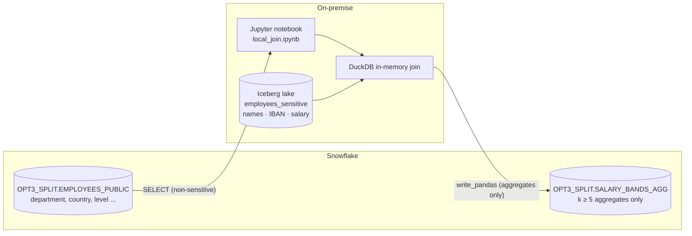

# Option 3 – Split storage, local join

**Idea:** the strictest option. Snowflake only ever holds **non-sensitive** attributes. Sensitive columns stay
on-premise. When a combined view is needed, an on-premise notebook pulls the non-sensitive rows from Snowflake,
reads the sensitive rows locally and joins them **in local memory**. Optionally, only k-anonymous aggregates are
pushed back into Snowflake.

## Architecture



No tunnel, no inbound connectivity: the on-prem host is an ordinary Snowflake client.

## Verified in the demo account

* 200 non-sensitive rows from Snowflake are joined with 200 sensitive rows from the local Iceberg lake.
* 22 department × country bands with at least 5 employees are written back. Smaller groups are suppressed.
* Snowflake's own `QUERY_HISTORY_BY_SESSION` for the notebook session shows only `SELECT * FROM EMPLOYEES_PUBLIC`
  and the aggregate load. No sensitive value appears in any Snowflake query, result or stage.

## Run

```bash
cd opt3-local-join
pixi run setup-snowflake      # schema, role, EMPLOYEES_PUBLIC, aggregate table
pixi run lab                  # or: pixi run run  (headless execute)
```

It uses the same on-prem lake as Option 1 (`cd ../opt1-tunnel && pixi run start && pixi run seed`).

## Trade-offs

* The joined row-level data is outside Snowflake governance (RBAC, masking, lineage, access history). Governance
  must come from the on-prem environment.
* Compute and memory are limited to the local host. This fits analytics on extracts, but not full-lake scans.
* The Snowflake UX (Snowsight notebooks, Cortex, BI connectors) doesn't see the combined data.
* Aggregates pushed back may still allow inference. k-anonymity is a simple guard; differential privacy or
  Snowflake aggregation policies on the target table could be layered on top.
