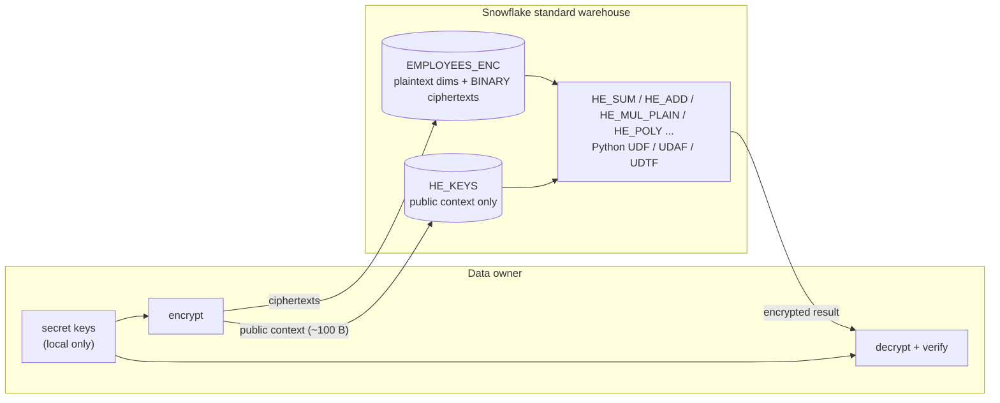
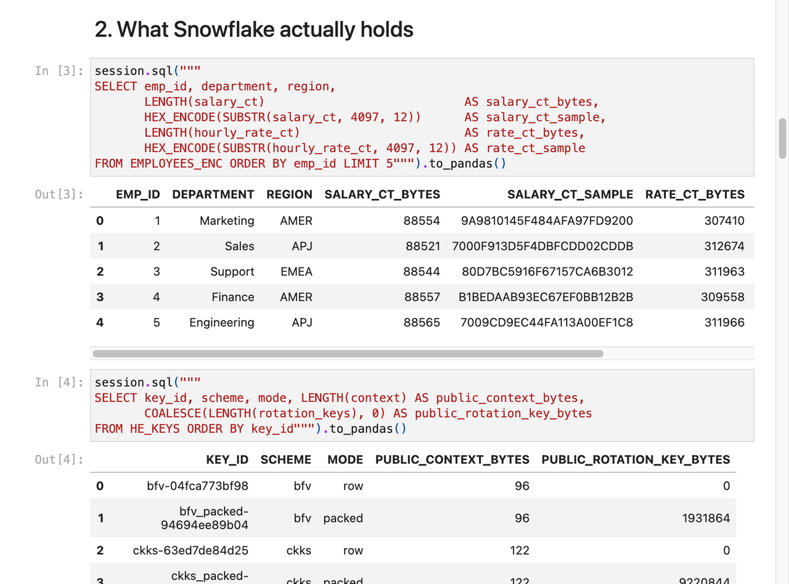
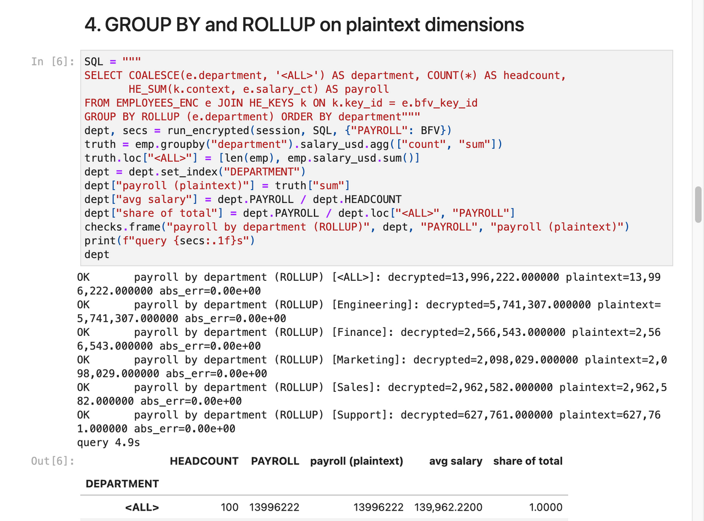

# Bonus – Homomorphic encryption for salaries and numbers

**Idea:** some numeric columns, such as salaries, bonuses and rates, never need to be *seen* in Snowflake, only
*computed on*. With homomorphic encryption (Microsoft SEAL via Pyfhel), Snowflake computes sums, averages, net pay,
statistics and even linear model scores **on ciphertexts**. Only the data owner can decrypt the result. Snowflake
holds no secret key at all, not even transiently, unlike Option 2.

Source: [snowflake-homomorphic-encryption](https://github.com/sfc-gh-kkeller/snowflake-homomorphic-encryption)
(copied into `bonus-homomorphic/`). Here it is deployed to `SOVEREIGNTY_DEMO.HE` in the demo account.



## What works and what doesn't

| Works on ciphertext | Not possible with these schemes |
|---|---|
| SUM / COUNT / AVG, GROUP BY on plaintext dimensions | `WHERE salary > x`, `ORDER BY`, MIN/MAX |
| net pay = salary + bonus − deductions | joins on encrypted keys |
| constant arithmetic (raises, FX conversion, employer cost) | division by an encrypted value |
| variance, std dev, correlation, regression (CKKS) | |
| linear / polynomial model scoring | |
| running totals, MoM deltas (UDTF + window) | |

## Where it fits among the customer-held controls

* **Complement to Option 2:** encrypt identifying columns with AES (decryptable under step-up) and keep numeric
  columns homomorphically encrypted. Most analytics then run without ever releasing a key.
* **Complement to Option 3:** aggregates can be computed in Snowflake on ciphertexts and decrypted on-prem,
  with no row-level pull needed.
* **Cost:** ciphertexts are large (BFV about 86 KB per value, CKKS about 300 KB). Packed (SIMD) mode puts a whole
  column into one ciphertext. This suits targeted, high-value columns, not whole tables.

## Verified in the demo account

* 21 offline handler tests passed (vendored Pyfhel 3.4.2 + SEAL 4.1.2).
* Deployed 13 homomorphic functions plus tables to `SOVEREIGNTY_DEMO.HE` and loaded 100 encrypted employees.
* `01_basics`, `02_advanced` and `03_packed_simd` all executed against Snowflake with **0 errors**. Every
  decrypted result is checked against plaintext ground truth inside the notebooks.

## Run

```bash
cd bonus-homomorphic
pixi install && pixi run test        # builds vendored Pyfhel 3.4.2 + SEAL 4.1.2, 21 offline tests
pixi run deploy && pixi run load     # SOVEREIGNTY_DEMO.HE (config.toml)
pixi run demo                        # executes the 3 notebooks; every result checked against plaintext
```

## Screenshots

Captured from the demo account. Names, IBANs, individual salaries, account identifiers, endpoint URLs, QR codes and keys are blurred or replaced.


*What Snowflake holds: ciphertext blobs and public HE parameters only*


*GROUP BY / ROLLUP computed on ciphertext, decrypted locally and checked against plaintext*
