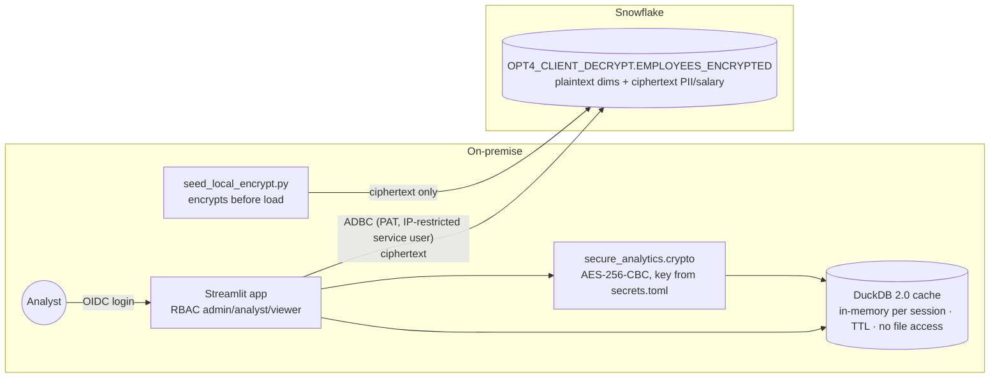

# Option 4 – Ciphertext in Snowflake, decryption only in an on-prem app

**Idea:** sensitive columns are stored in Snowflake as AES-256-CBC ciphertext. The **only** place that holds the
key is an on-prem analytics app (Streamlit, behind OIDC). It pulls ciphertext over ADBC/Arrow, decrypts in memory,
and caches the plaintext in a local DuckDB with a TTL. Snowflake does storage, filtering and aggregation on the
plaintext dimensions. It never sees a key, a plaintext value, or a plaintext result.

Source: your `secure-snowflake-analytics` project, unpacked into `opt4-client-decrypt/`.



## Where it sits among the options

| vs. | Difference |
|---|---|
| Option 2 (key broker) | Same "ciphertext at rest in Snowflake", but **no key ever enters Snowflake**, not even transiently. The cost is losing the Snowflake UX for the decrypted view: Snowsight and Cortex see ciphertext. |
| Option 3 (local join) | Similar "decrypt and join only on-prem", but the sensitive data *is* stored in Snowflake (encrypted). That simplifies storage, backup and sharing, and avoids a separate on-prem lake. |
| Homomorphic | HE computes on ciphertext in Snowflake; Option 4 computes on plaintext locally. |

## Changes for the sovereignty-demo demo

The app was rewritten from one 2,270-line `main.py` into a multipage app with a UI-free core package. It keeps
every feature and is covered by 31 unit tests.

* **Navigation:** five pages (Connect, Query, Explore, Compare, Admin) with top navigation. A sidebar shows the
  identity, connection, key and cache status. Theme comes from `config.toml`, not CSS.
* **Sign-in:** `st.login` (OIDC). The old "Test Login" buttons became a dev sign-in that only appears when
  `[app].dev_login = true` and shows a red banner. Roles come from `[roles]` in secrets.
* **Key handling:** the published default key was removed. The setup generates a fresh key into
  `.secrets/aes_key.b64` and `.streamlit/secrets.toml`, and the app refuses to decrypt without one.
* **Query hardening:** user SQL goes through sqlglot (one read-only statement, no table functions). DuckDB runs
  with external access disabled and its configuration locked, so `read_csv('/etc/hosts')` is rejected at both
  layers. The cache TTL is enforced on every read.
* **No leaks:** the server binds to localhost with CORS on. Telemetry, browser error details and grid data export
  are off. The old debug output, which printed ciphertext and plaintext samples to the page and log, is gone.
* **Dependencies:** DuckDB 2.0, Streamlit 1.66, cryptography 50 and Python 3.13 via `pixi.toml`, on
  macOS, Linux and Windows.
* **Encryption happens client-side.** `seed_local_encrypt.py` uses the app's wire format (`base64(ct) || base64(iv)`).
* Dedicated `TYPE=SERVICE` user `SOV_CLIENTDEC_APP` with a role-restricted PAT and a network policy that
  allows only the on-prem egress IP.

## Verified

* In the browser, against the demo account: dev sign-in → Connect (pre-filled) → 200 rows decrypted, 0 failures.
  The local average salary per department (Engineering 100,486 … Sales 93,031) is identical to the plaintext
  source data.
* *Live source* mode returns ciphertext for SALARY/IBAN; *Local cache* returns `65149` / `DE9690…` for the same
  row.
* `read_csv('/etc/hosts')`, `DELETE` and multi-statement SQL are rejected in cache and live mode.
* The viewer role sees only Connect, Query and Explore, and cannot connect or query live.

## Run

```bash
cd opt4-client-decrypt
pixi run setup     # Snowflake schema/role/service user + PAT, AES key, secrets.toml, encrypt + load 200 rows
pixi run app       # http://localhost:8501 → sign in (dev) → Connect (pre-filled) → Query
```

Example in *Local cache* mode:
`SELECT DEPARTMENT, ROUND(AVG(SALARY)) FROM SOVEREIGNTY_DEMO.OPT4_CLIENT_DECRYPT.EMPLOYEES_ENCRYPTED GROUP BY 1`.
Source table names are mapped to the local decrypted cache. Switch to *Live source* to show what Snowflake holds.

## Things to discuss openly

* AES-CBC with PKCS7 has no integrity protection. AES-GCM, as in Option 2, would detect tampering with
  ciphertext in Snowflake.
* The key sits in a secrets file on the app host. An HSM, KMS or Vault lookup at startup could replace that.
* Aggregations on encrypted columns can't be pushed down to Snowflake. The table is pulled (row-capped) and
  computed locally, which suits departmental data volumes rather than full-table scans.
* Dev sign-in is for demos. A shared deployment could use only OIDC (`[app].dev_login = false`) behind a TLS
  reverse proxy.
