<!-- _class: lead -->
<!-- _paginate: false -->
<!-- _footer: "" -->

# Customer-Held Controls for Data Sovereignty in Snowflake

## Keeping control of the most sensitive data – while still using Snowflake

Four architecture options and one bonus, each built and demonstrated end to end

Kevin Keller, Principal Security Architect & Field CTO at Snowflake – personal work. "Art of the possible" examples for inspiration; not official Snowflake solutions and not endorsed by Snowflake.

---

## The question behind every option

**"Who can turn the data off – and can the platform ever see it in clear?"**

Most data can live natively in Snowflake with standard governance. For a small set of
highly regulated data, customers sometimes ask for a stronger guarantee:

- the data must **not be stored** in a foreign cloud at all, or
- it may be stored, but only **encrypted with a key the customer holds**, or
- the platform may compute on it, but must **never see a plaintext value**

These options are not a replacement for Snowflake's native security (Tri-Secret Secure,
masking, row access policies, private connectivity). They are **additional patterns** for the
few datasets where the customer wants the switch in their own hands.

---

## The options at a glance

| | Where the sensitive data lives | Who holds the switch | Snowflake sees plaintext | Snowflake UX kept |
|---|---|---|---|---|
| **1 Tunnel** | on-prem Iceberg lake | data owner: tunnel on/off, TTL | only during a query while the tunnel is up | yes |
| **2 Key broker** | Snowflake, AES-256-GCM ciphertext | data owner: KMS + broker in own AWS | only during a RUNNING query of a stepped-up user | yes, via masking policy |
| **2b EAI key fetch** | Snowflake, AES-256-GCM ciphertext | data owner: vault authorizes the integration | only during a query (key memo per query) | yes, via masking policy / view |
| **2c Device-flow key** | Snowflake, AES-256-GCM ciphertext | data owner: IdP approval + broker checks the running query | only during a running query, in the approved session | yes, via SQL function |
| **3 Local join** | on-prem only | data owner – data never leaves | never | no (local notebook) |
| **4 Client decrypt** | Snowflake, AES-256 ciphertext | data owner: key only in on-prem app | never | no (on-prem app) |
| **HE bonus** | Snowflake, homomorphic ciphertext | data owner: secret key stays local | never | partly (encrypted aggregates) |

---

## Decision guide


Options can be combined: native data for the bulk, Option 2 for PII columns, homomorphic encryption for salary figures, Option 1 or 3 for data that may not be stored in the cloud at all.

---

<!-- _class: divider -->

# Option 1
## On-demand tunnel to an on-prem Iceberg lake

Sensitive data stays on-prem. Snowflake queries it live – only while the data owner has opened the tunnel.

---

## Option 1 – The simple picture


<b>1</b> You switch the line **on**, for a fixed time

<b>2</b> Snowflake asks its question through the line

<b>3</b> The answer comes back live

<b>4</b> Time's up → the line is closed and the data is unreachable

---

## Option 1 – In plain words

Like a <strong>phone line to your own archive</strong> that only you can switch on. Snowflake can ask questions while the line is open – but it never gets a copy of the files.

### Where is the data?
In your building. Never stored in the cloud.

### Who decides?
You: on/off switch with a timer and a written reason.

### Good for
Data that may **not be stored** in a foreign cloud, but still needs to be queried there now and then.

**Catch:** only as fast as your line and your server – best for targeted questions, not huge scans.

---

## Option 1 – Architecture


outbound WSS onlyhard TTL + reasonVOLATILE + nonce → no result cacheSPCS

---

## Option 1 – How it works

1. The data owner runs `tunnel-up --ttl 15m --reason "…"` – resumes the SPCS service if needed and
   starts the on-prem agent. Every open/close is written to an on-prem audit log.
2. The agent opens an **outbound** WebSocket to the SPCS sidecar (PAT → OAuth, RSA + AES session).
   No inbound firewall ports.
3. Analysts query `EMPLOYEES_SENSITIVE_LIVE` – a secure view over `QUERY_ONPREM()`, which proxies to
   DuckDB reading the Iceberg tables on-prem.
4. `VOLATILE` + `UUID_STRING()` nonce: every query goes through the tunnel; there is no result cache hit.
5. TTL expires or `tunnel-down` → the next query returns no data (the view is empty; the function returns the agent's connection error as a value). Nothing to delete in Snowflake.

Verified: join of Snowflake public data + on-prem sensitive data, 200 rows; four identical runs, never cached; after tunnel-down: no data (0 rows, connection error returned as a value).

---

## Option 1 – Pros and cons

### Pros
- Sensitive data is **never persisted** in Snowflake
- Data owner has a physical **kill switch** with TTL and audit trail
- Full Snowflake UX: SQL, views, joins with native data, notebooks
- No inbound ports – agent dials out
- No result-cache exposure by design

### Cons
- Throughput bound by the network and the on-prem host; best for bounded queries, not full scans
- Moving parts: SPCS service + compute pool, on-prem agent, Iceberg catalog
- Horizon governance (masking, lineage) does not apply to the on-prem rows unless synced
- While the tunnel is up, plaintext exists in query memory
- Availability depends on the on-prem side

---

## Option 1b – Notebook and own query engine through the tunnel

A Snowflake Notebook or a custom notebook on SPCS (Jupyter, marimo) queries through the tunnel with **DuckDB**,
bypassing Snowflake's query engine: **no query result, no result cache, nothing to `RESULT_SCAN`**.

### Gained
- Nothing about the sensitive data is stored in Snowflake, not even a cached result
- The Snowflake experience is kept with Snowflake Notebooks
- Any engine: DuckDB, PyIceberg, Polars …

### Lost
- The compute power of Snowflake's query engine: one notebook container does the work
- On-demand elasticity (warehouse scaling, multi-cluster)
- Snowflake governance on this data path

**Not in the demo yet: passing the user's identity through to the on-prem source** (e.g. an Iceberg catalog). Options:
out of band, a device-code token from an external identity provider started from the notebook (as in 2c), or a proof
of the Snowflake identity taken from the user context or notebook secrets. One Iceberg pattern is planned.

---

<!-- _class: divider -->

# Option 2
## Column-level AES-256 + external key broker with step-up

Ciphertext at rest in Snowflake. The key is released per query – only to a stepped-up user, only while that query is running.

---

## Option 2 – The simple picture


<b>1</b> Analyst confirms identity on the phone and says why

<b>2</b> Runs a normal query

<b>3</b> Snowflake asks your gatekeeper for the key

<b>4</b> Gatekeeper checks person + running query

<b>5</b> Key lent for this one query

<b>6</b> Readable answer

---

## Option 2 – In plain words

Like a <strong>bank safe-deposit box</strong>: the box sits in Snowflake's vault, but the key sits in <em>your</em> key safe. Every time someone wants to open it, your gatekeeper checks who they are and why – and lends the key for that one moment only.

### Where is the data?
In Snowflake, locked. Unreadable without your key.

### Who decides?
Your gatekeeper in your AWS account: phone code + reason, time-limited, every release logged.

### Good for
Sensitive columns (names, IDs, salaries) that should stay in Snowflake and be **used normally** – by approved people only.

**Catch:** while an approved query runs, the data is readable in Snowflake for that moment; a few extra seconds per query.

---

## Option 2 – Architecture


AWS KMS + Lambda in the customer's accountTOTP + justificationmasking policy

---

## Option 2 – Key release sequence

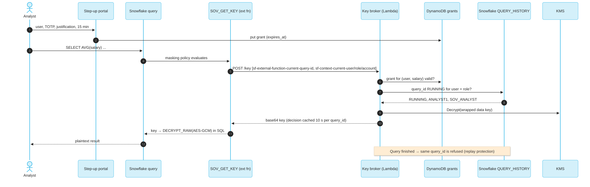

---

## Option 2 – How it works

1. Columns are encrypted **before load** (AES-256-GCM, data key from KMS); Snowflake stores ciphertext
   and never holds the KMS key.
2. A masking policy calls `SOV_DECRYPT(value, SOV_GET_KEY('salary'))` – an **IMMUTABLE**
   external function, so the key is fetched about once per query, not per row.
3. The broker checks: valid step-up grant (TOTP + written justification, time-boxed)? Then it calls back
   into Snowflake: is **this query_id RUNNING** for this user, role and account?
4. Only then is the data key unwrapped by KMS and returned. Finished query_ids are refused (replay protection).

| Role / state | Result |
|---|---|
| Viewer | `**ENCRYPTED**` – policy never asks for a key |
| Analyst, no step-up | `**KEY DENIED**` |
| Analyst after step-up | plaintext, aggregates in Snowflake – identical to Option 1 |
| Grant expired / revoked | `**KEY DENIED**` again |

---

## Option 2 – Pros and cons

### Pros
- Data stays in Snowflake – storage, sharing, backup, performance unchanged
- **Transparent** for authorized users: normal SQL, BI, notebooks
- Key and decision live in the **customer's** AWS account; every release is audited with justification
- Step-up and time-boxing per classification (salary, PII …)
- Replay-proof: key only for a currently running query
- Fails closed on any error

### Cons
- While a query runs, the key and plaintext exist in Snowflake compute memory
- An authorized user can still copy what they see (CTAS, export) – could be reduced with additional controls
- Latency: about 4 s per decrypting query (plaintext 0.1 s), incl. the RUNNING call-back
- AWS stack to operate: KMS, Lambda, API Gateway, DynamoDB, API integration
- Encrypted columns can't be filtered or joined on without decryption

---

<!-- _class: divider -->

# Option 2b
## Key fetched by an External Access UDF, cached per query

A lighter variant of Option 2: no Lambda or API Gateway. A Python UDF fetches the key from your vault and remembers it only while the query runs.

---

## Option 2b – The simple picture


<b>1</b> Analyst runs a normal query

<b>2</b> A worker in the warehouse needs the key

<b>3</b> It fetches the key once from your key safe

<b>4</b> Key used for this query only

<b>5</b> Readable answer – the key is forgotten

---

## Option 2b – In plain words

Like a <strong>contractor who borrows your key for one job</strong>: they collect it from your key safe when the job starts, use it for every room, and give it back when the job is done. The next job means collecting it again.

### Where is the data?
In Snowflake, locked – same as Option 2.

### Who decides?
Your key safe decides whether Snowflake's integration may fetch the key; Snowflake roles decide who may run the query.

### Good for
Teams that want "key stays with us" with **minimal extra infrastructure** – any vault, even over a private link.

**Catch:** your key safe sees "Snowflake", not which analyst or query – no phone step-up unless added on top.

---

## Option 2b – Architecture and measurements


| Measured (X-Small warehouse, probe UDF with and without EAI) | Result |
|---|---|
| Next query – new session, other role, or same session after 20 s | **new Python process, memo empty** |
| One query over 5,000 rows | 8 parallel processes → **8 key fetches instead of 5,000** |
| Vodafone POC, 2,000 rows via PrivateLink vault | plain UDF 2,000 calls · memo UDF **1 call, ~1 s** |

The memo lives for one query. Observed behaviour, not a documented guarantee – a design should be safe either way (TTL, key the memo by user and role).

---

## Option 2b – Pros and cons

### Pros
- Far less to run: network rule, secret / OAuth, External Access Integration – no Lambda, API Gateway, DynamoDB
- Works with any HTTPS key service, including outbound PrivateLink
- Key only in UDF memory for one query (as measured); never stored in Snowflake
- One fetch per process per query; native AES-GCM decryption in SQL
- Kill switch: disable the integration or revoke the token

### Cons
- Key service authorizes the **integration**, not the analyst or query – unless the UDF passes user, role and query ID itself
- No step-up or replay protection out of the box (Option 2 has both)
- Authorization relies on Snowflake RBAC on the UDF / masking policy
- Key exists in compute memory during the query (as in Option 2)
- Process lifetime is platform behaviour, not a contract

---

<!-- _class: divider -->

# Option 2c
## Sign in on your phone, get a session pass, every key fetch checked against the running query

Option 2's controls (a person approves, with a reason, and each release is bound to a query) on Option 2b's light transport.

---

## Option 2c – The simple picture


<b>1</b> Analyst asks for a sign-in code – gets a QR in the result

<b>2</b> Scans it, approves on the phone with the authenticator code and a reason

<b>3</b> Gets a pass for this session only

<b>4–6</b> Each query shows the pass; the key service checks the query is running now

<b>7–8</b> Key for this query only – readable answer

---

## Option 2c – In plain words

Like a <strong>visitor badge</strong>: you sign in at reception with your phone and say why you are there. The badge works only for you, only today, only in this building – and the guard still checks it every time you open a door.

### Where is the data?
In Snowflake, locked – same ciphertext as Option 2.

### Who decides?
Your sign-in service (approval with MFA and a reason) and your key service (is this query really running, for this person, in this session?).

### Good for
Teams that want **per-person, per-session approval** without API Gateway – and an audit line per query.

**Catch:** more to run than 2b (sign-in service and key service), and each query waits about 0.3 s for the check.

---

## Option 2c – Sequence

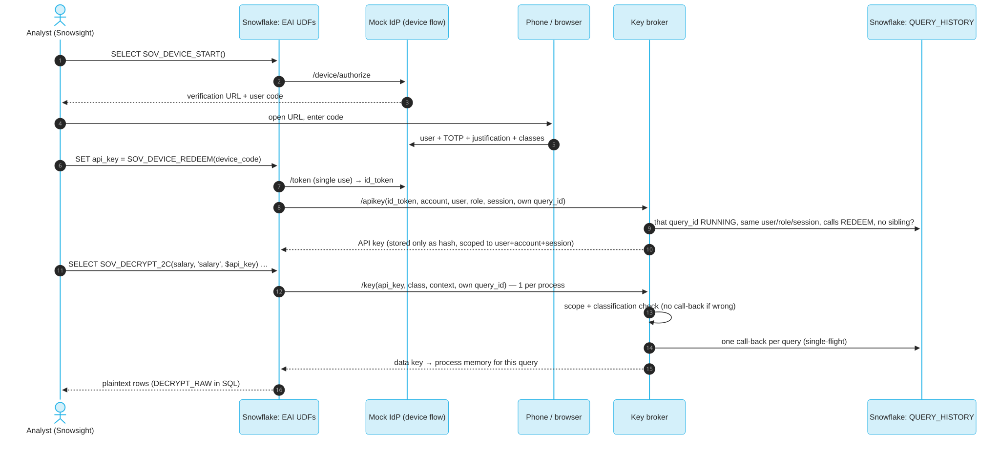

---

## Option 2c – Which query is asking? Two approaches measured

| 15 runs each, X-Small | A: query passes its own id | B: broker looks up the session |
|---|---|---|
| Correct binding, 10 / 5,000 / 100,000 rows | 45/45 | 45/45 |
| Back-to-back queries, same key | **15/15** | 8/15 (bound to the previous query) |
| Forged or finished query id | denied | n/a |
| Two async queries in one session | denied (fail closed) | denied |
| Call-backs per query | 1 | 1 |
| Added time per query (p50) | ~0.3 s | ~0.6 s |

A uses the community-article pattern (QUERY_HISTORY_BY_SESSION, newest first) behind a secure view, so the analyst never types it. Observed behaviour, not a documented contract; B stays available as a fallback.

---

## Option 2c – Pros and cons

### Pros
- MFA approval with a written justification, per session, on a second device
- API key only valid for that user, account and session – stored only as a hash
- Every key release bound to an exact running query id, one audit line per query
- No API Gateway or API integration; PrivateLink possible
- Wrong scope or classification refused without touching Snowflake

### Cons
- Sign-in service and key service to operate (mock IdP here; Okta or Entra in practice)
- About 0.3 s extra per query for the call-back
- Self-id pattern is observed behaviour; owner's-rights procedures can't use it
- API key sits in a session variable, visible to the same user
- Key in compute memory during the query (as in 2 and 2b)

---

## Option 2d – Remote decrypt: the key never enters Snowflake

Same phone approval, API key and query binding as 2c – but the broker **never hands out the key**.
A vectorized UDF sends batches of ciphertext (up to 2,000 values); the broker decrypts in AWS and returns plaintext.
Also the shape for external **de-tokenization**.

### Pros
- No data key in Snowflake, not even in query memory
- Broker logs every batch: user, query id, classification, rows, failures
- Strict variant raises instead of returning NULL – safe for CTAS and Dynamic Tables

### Cons
- Plaintext crosses the network on the way back (TLS; PrivateLink possible)
- Cost grows with rows – one call per batch
- Same observed-behaviour caveat as 2c

Key custody ≠ data custody: decrypting upstream before loading also keeps the key out of Snowflake, but puts plaintext in Snowflake from the first table on.

---

<!-- _class: divider -->

# Option 3
## Split storage – local join

Only non-sensitive data lives in Snowflake. The sensitive half never leaves the premises; joins happen locally.

---

## Option 3 – The simple picture


<b>1</b> Copy the harmless half from Snowflake

<b>2</b> Combine it with the sensitive half on your own machine

<b>3</b> Optionally send back only totals (groups of 5 or more)

---

## Option 3 – In plain words

Like <strong>tearing a form in half</strong>: the harmless half (department, country) goes to the cloud, the half with names and salaries never leaves your drawer. You only put the two halves together at your own desk.

### Where is the data?
Sensitive part: only in your building. Snowflake has the harmless part.

### Who decides?
Nobody needs to – the sensitive part simply isn't there.

### Good for
Data that must **never leave** the premises, while the rest still benefits from Snowflake.

**Catch:** the combined view only exists on your machine – no Snowflake tools or scale for it.

---

## Option 3 – Architecture


- Snowflake holds `EMPLOYEES_PUBLIC` (department, country, level …) – **no names, no IBANs, no salaries**
- A local notebook pulls the public half, joins it in DuckDB with the on-prem lake
- Optional write-back: only **k-anonymous aggregates** (k ≥ 5) return to Snowflake

Verified: 200 + 200 rows joined locally; 22 department × country bands written back, smaller groups suppressed; Snowflake query history shows only the SELECT on the public table.

---

## Option 3 – Pros and cons

### Pros
- Strongest guarantee: sensitive data is **never** in Snowflake, encrypted or not
- Simplest to operate – no service, no key infrastructure
- Snowflake still serves all non-sensitive analytics at scale
- Aggregates can flow back for dashboards

### Cons
- Joined row-level data is outside Snowflake governance (RBAC, masking, lineage, access history)
- Compute limited to the local host
- Snowflake UX (Snowsight, Cortex, BI) doesn't see the combined data
- Aggregates can still allow inference; k-anonymity is a simple guard, differential privacy could be stronger

---

<!-- _class: divider -->

# Option 4
## Ciphertext in Snowflake, decryption only in an on-prem app

Snowflake stores and filters. Only an on-prem analytics app holds the key and sees plaintext.

---

## Option 4 – The simple picture


<b>1</b> Data is locked before upload

<b>2</b> Analyst signs in to your app

<b>3</b> App fetches the locked data

<b>4</b> App unlocks it on your machine and shows it

---

## Option 4 – In plain words

Like <strong>storing locked suitcases</strong> in a cloud warehouse: the warehouse keeps them safe and can sort them by label, but only your own app at home has the key to open them.

### Where is the data?
In Snowflake, locked. Labels (department, country) readable.

### Who decides?
Your app: sign-in and roles. The key never goes to Snowflake.

### Good for
A small, trusted team that needs to read the real values – outside the cloud.

**Catch:** Snowflake's own tools only see locked values; the work happens in your app.

---

## Option 4 – Architecture


- Sensitive columns encrypted client-side before load; plaintext dimensions stay queryable in Snowflake
- On-prem Streamlit app: OIDC sign-in, roles viewer / analyst / admin
- Ciphertext pulled over ADBC/Arrow by an IP-restricted service user, decrypted **in memory**, cached per session with a TTL
- Local SQL is read-only and sandboxed (no file or network access from the cache)

---

## Option 4 – Pros and cons

### Pros
- **No key ever enters Snowflake** – not even transiently
- Data is still stored, backed up and shareable in Snowflake
- Snowflake can filter and group on the plaintext dimensions
- One app plus key handling – low operating effort
- Plaintext lives only in a per-session, in-memory cache with TTL

### Cons
- No Snowflake UX on decrypted data: Snowsight and Cortex see ciphertext
- No pushdown on encrypted columns – data is pulled and computed locally; suits departmental volumes
- AES-CBC as built has no integrity check; AES-GCM could detect tampering
- The key sits on the app host; an HSM / KMS / Vault fetch could replace that

---

<!-- _class: divider -->

# Bonus
## Homomorphic encryption

Snowflake computes on ciphertext it can't read. Only the data owner can decrypt the result.

---

## Homomorphic – The simple picture


<b>1</b> Numbers are locked with a special lock and uploaded

<b>2</b> Snowflake calculates on the locked numbers

<b>3</b> The locked result comes back, only you can open it

---

## Homomorphic – In plain words

Like giving an accountant <strong>sealed envelopes</strong> that can still be added up: the accountant computes the total without ever opening an envelope – and hands you a sealed total that only you can open.

### Where is the data?
In Snowflake, locked – and it stays locked, even while being calculated.

### Who decides?
You: only you have the key to open results.

### Good for
Salaries and financial numbers where you need **totals and averages**, never individual values.

**Catch:** only arithmetic (sums, averages, scores) – no sorting or filtering by value; slower and larger data.

---

## Homomorphic encryption – Architecture


- BFV (integers) and CKKS (decimals) via Python UDFs / UDAFs / UDTFs on a standard warehouse
- Only a public context (~100 B) is stored in Snowflake; the secret key never leaves the owner

---

## Homomorphic encryption – What works

| Works on ciphertext | Not possible with these schemes |
|---|---|
| SUM / COUNT / AVG, GROUP BY on plaintext dimensions | `WHERE salary > x`, `ORDER BY`, MIN / MAX |
| net pay = salary + bonus − deductions | joins on encrypted keys |
| raises, FX conversion, employer cost (constants) | division by an encrypted value |
| variance, std dev, correlation, regression (CKKS) | |
| linear / polynomial model scoring | |
| running totals, month-over-month deltas | |

### Pros
- Snowflake **never** sees a plaintext value or result
- Real analytics inside the platform – aggregates, statistics, scoring

### Cons
- Large ciphertexts (BFV ~86 KB, CKKS ~300 KB per value) and slower operations
- Only arithmetic – no comparisons, sorting or joins on encrypted values

---

## Threat model – what each option is designed to resist

| Threat | Opt 1 Tunnel | Opt 2 Key broker | Opt 3 Local join | Opt 4 Client decrypt | HE |
|---|---|---|---|---|---|
| Platform operator reads data at rest | ✔ not stored | ✔ ciphertext, key external | ✔ not stored | ✔ ciphertext, key on-prem | ✔ |
| Over-privileged Snowflake admin queries sensitive data | ✔ when tunnel down | ✔ without step-up | ✔ | ✔ | ✔ |
| Stolen Snowflake credentials | ✔ when tunnel down | ✔ no TOTP → no key | ✔ | ✔ | ✔ |
| Replay of a previous authorization | n/a | ✔ query must be RUNNING | n/a | n/a | n/a |
| Legal compulsion against the platform | ✔ | ✔ key held elsewhere | ✔ | ✔ | ✔ |
| Authorized user exfiltrates what they may see | ✘ | ✘ could be reduced | ✘ | ✘ | ✔ only aggregates |

---

## Trade-offs side by side

| | Opt 1 Tunnel | Opt 2 Key broker | Opt 3 Local join | Opt 4 Client decrypt | HE |
|---|---|---|---|---|---|
| **Performance** | network-bound | ~4 s per query | local host | pull + decrypt locally | heavy |
| **Operating effort** | SPCS + agent + lake | AWS stack + API integration | lowest | one app + key | moderate |
| **Snowflake governance on sensitive rows** | RBAC on view / function | full (masking, RBAC, access history) | none (on-prem) | RBAC on ciphertext + app RBAC | RBAC, values opaque |
| **Step-up / justification** | `--reason`, TTL, audit log | TOTP + justification, time-boxed | local access control | OIDC + app roles | n/a |
| **Typical fit** | data that may not be stored in a foreign cloud | sensitive columns that must stay in the platform under external key control | data that must never leave the premises | encrypted-at-rest data for a small trusted analyst group | salaries / financials needing only arithmetic |

---

## One possible layering

| Data class | Possible pattern |
|---|---|
| Bulk analytics data | native Snowflake + standard governance (Tri-Secret Secure, masking, RBAC) |
| PII columns (names, IDs, IBAN) | **Option 2** – readable only after step-up, per query |
| Salary and financial figures | **Homomorphic** – aggregated in Snowflake, never decrypted there |
| Data that must not be stored in a foreign cloud | **Option 1** (live, on demand) or **Option 3** (local only) |
| Small expert group needing row-level plaintext outside the platform | **Option 4** |

The options are independent building blocks – a customer could start with one dataset and one pattern.

---

## Live demo flow

| # | Prepare | Show in Snowsight |
|---|---|---|
| 1 | `pixi run tunnel-up 15m "demo"` | public table → live join through the tunnel → `tunnel-down` → query returns no data |
| 2 | phone with TOTP, step-up portal | viewer `**ENCRYPTED**` → analyst `**KEY DENIED**` → step-up → plaintext + averages |
| 3 | – | Snowflake holds only non-sensitive columns + k-anonymous aggregates |
| 4 | on-prem app (optional) | 200 rows in Snowflake as ciphertext; `AVG(salary)` NULL; app shows plaintext |
| HE | – | encrypted salary sum per department computed in Snowflake |

Script: <code>snowsight_demo.sql</code> · Code and docs: <code>sovereignty-demo/</code> repository · every option deployed and verified on a Snowflake demo account (AWS eu-central-1)

---

## Possible next steps

- Pick **one dataset** and the data owner's real requirement (not stored / encrypted with own key / never in clear)
- Map it on the decision guide and agree on the pattern
- Pilot: hardening items per option are documented
  - Opt 1: approval workflow for `tunnel-up`, audit log into the SIEM
  - Opt 2: corporate IdP step-up instead of TOTP, VPC Lambda with fixed egress, audit into an event table
  - Opt 3: differential privacy for write-back aggregates
  - Opt 4: AES-GCM, key from HSM / KMS / Vault, OIDC-only sign-in behind TLS
  - HE: packed (SIMD) mode for larger tables

<!-- _class: "" -->
